<!-- Banner -->
<p align="center">
  
</p>

<p align="center">
  <a href="https://www.linkedin.com/in/ryan-ruis-b1a0a6277"></a>
  <a href="mailto:ryan.ruissilvaatitude@gmail.com"></a>
  
  
</p>

<p align="center">
  
</p>

---

## 📡 Reconhecimento do alvo

```console
ryan@ruis:~$ nmap -sV --script=perfil ryan-ruis

PORT      STATE     SERVICE     VERSION
22/tcp    open      linux       Bash · Shell Script · permissões · SUID
53/tcp    open      redes       TCP/IP · modelo OSI · endereçamento · serviços
80/tcp    open      python      POO · automação · ferramentas CLI com Rich
443/tcp   open      security    Seg. da Informação (UNIP) · Fortinet · Cloud
8080/tcp  open      suporte     SaaS · troubleshooting · reprodução de falhas
3306/tcp  filtered  sql         em estudo...

| perfil-info:
|   localização : Santo André - SP, Brasil
|   foco        : auditoria Linux, redes e Python para segurança
|_  status      : aberto a oportunidades

Nmap done: 1 IP address (1 host up) scanned — 5 serviços abertos, 1 em evolução
```

<table>
  <tr>
    <td align="center" width="25%">🐧<br/><b>Linux</b><br/><sub>Shell, permissões e auditoria do sistema</sub></td>
    <td align="center" width="25%">🌐<br/><b>Redes</b><br/><sub>TCP/IP, modelo OSI e firewall</sub></td>
    <td align="center" width="25%">🐍<br/><b>Python</b><br/><sub>Ferramentas de linha de comando para segurança</sub></td>
    <td align="center" width="25%">🔍<br/><b>Investigação</b><br/><sub>Reprodução de falhas, evidências e causa raiz</sub></td>
  </tr>
</table>

> O suporte técnico me ensinou a reproduzir falhas e isolar causas. A segurança da informação me ensina a entender **como os sistemas quebram**, e a transformar isso em proteção.

---

## 🛡️ Projeto em destaque

<h3 align="center">🔎 <a href="https://github.com/ryan-ruis/suid-scanner">SUID Scanner</a></h3>
<p align="center"><b>Auditoria defensiva de arquivos com permissão SUID em sistemas Linux</b></p>

<p align="center">
  
  
  
  
  
</p>

O bit **SUID** pode fazer um programa rodar com os privilégios do dono do arquivo, muitas vezes o `root`. Por isso ele é um dos primeiros pontos verificados numa auditoria de escalonamento de privilégios. O SUID Scanner localiza esses arquivos e ajuda a priorizar a revisão:

| Recurso | Como funciona |
|---|---|
| 🔍 **Varredura** | `find -perm -4000` e reconfirmação do bit SUID via `os.stat` |
| 🚦 **Classificação de risco** | Catálogo heurístico: shells, interpretadores, editores e utilitários → **CRÍTICO · ALTO · MÉDIO · REVISAR** |
| 📋 **Contexto** | Permissões, dono, grupo, impacto e recomendação para cada achado |
| 📄 **Relatório** | Exportação em JSON para documentação e comparação entre varreduras |
| 🔐 **Somente leitura** | Não explora, não escala privilégios e não altera nenhum arquivo |

---

## 🧪 Outros projetos

| Projeto | Descrição | Stack |
|---|---|---|
| 🎮 [Pokémon Terminal RPG](https://github.com/ryan-ruis/Meu-jogo-Pokemon) | RPG no terminal com orientação a objetos: herança, polimorfismo e persistência com pickle |  |
| 📇 [Agenda de Contatos](https://github.com/ryan-ruis/Agenda-de-Contatos-em-Python) | CRUD em Python, usado também em aulas de programação e desenvolvimento seguro |  |

<details>
<summary><b>🗺️ Roadmap: próximos alvos</b></summary>
<br/>

- [x] Ferramenta de auditoria de permissões SUID no Linux
- [ ] Scanner de portas em Python (reconhecimento de rede)
- [ ] Testes automatizados e exportação CSV no SUID Scanner
- [ ] SQL e bancos de dados aplicados à investigação
- [ ] Automação com Selenium + Excel

</details>

---

## 🧰 Arsenal

<p align="center">
  
</p>

<p align="center">
  
  
  
  
</p>

<p align="center">
  
  
  
  
</p>

---

## 🎓 Formação & Certificações

| | Formação | Instituição |
|:-:|---|---|
| 🎓 | Tecnólogo em **Segurança da Informação** (último semestre) | UNIP |
| 🛡️ | **Cibersegurança com Soluções Fortinet** (60 h) | SENAI-SP |
| ☁️ | **Cibersegurança na Nuvem** (20 h) | SENAI-SP |
| 🔥 | **FortiGate 7.6 Operator** · **Technical Introduction to Cybersecurity 3.0** | Fortinet Training Institute |
| 🐧 | Linux e Shell Script para Pentesters · Fundamentos de Segurança e Pentest · Criptografia e Senhas | Solyd |
| 🐍 | Python Orientado a Objetos e Automação · Introdução ao Python e Algoritmos | Solyd |

---

## 📈 Atividade

<p align="center">
  
</p>

<p align="center">
  <picture>
    <source media="(prefers-color-scheme: dark)" srcset="https://raw.githubusercontent.com/ryan-ruis/ryan-ruis/output/github-snake-dark.svg"/>
    <source media="(prefers-color-scheme: light)" srcset="https://raw.githubusercontent.com/ryan-ruis/ryan-ruis/output/github-snake.svg"/>
    
  </picture>
</p>

---

<p align="center">
  
</p>
<p align="center">
  <sub>Segurança da Informação · Suporte Técnico N2 · Infraestrutura · Automação</sub><br/>
  <sub><code>// Hack ético: só teste o que você tem autorização para testar.</code></sub>
</p>

<p align="center">
  
</p>
